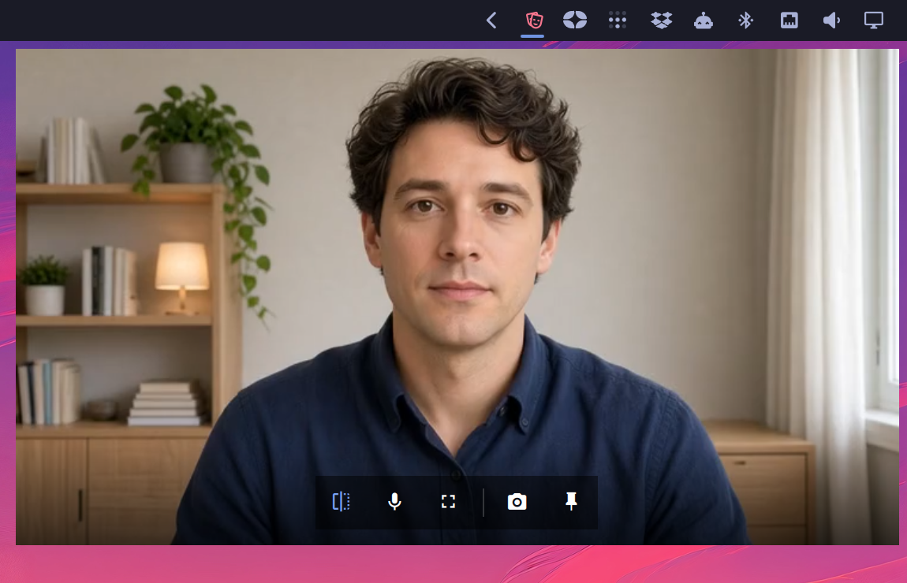
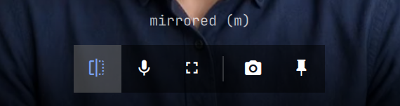
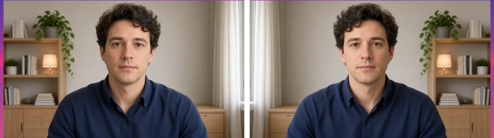
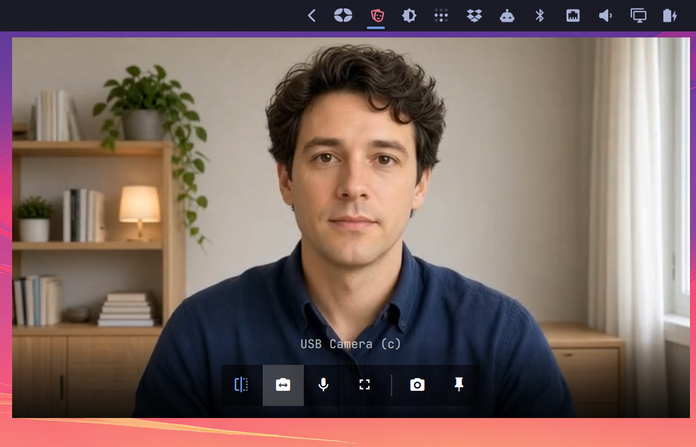
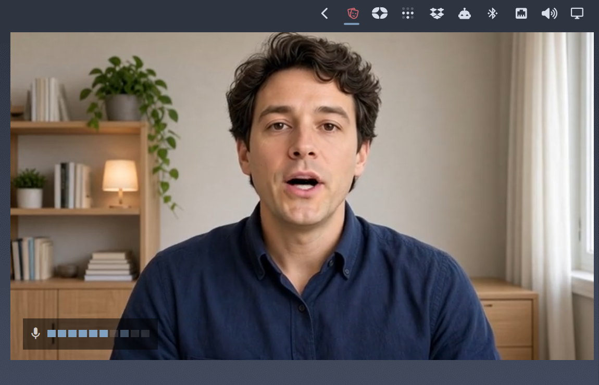
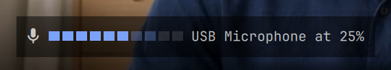
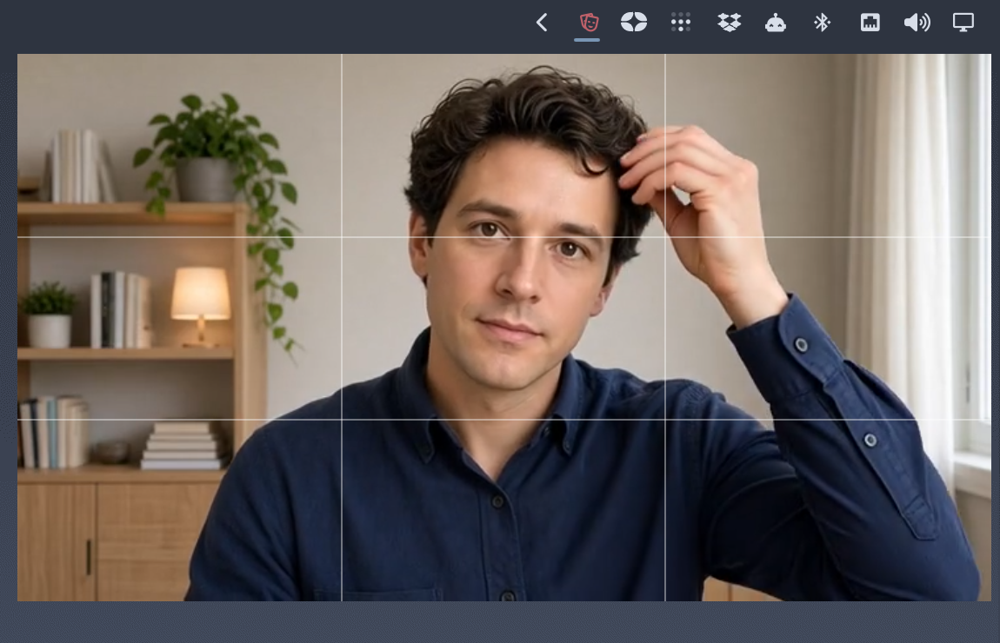
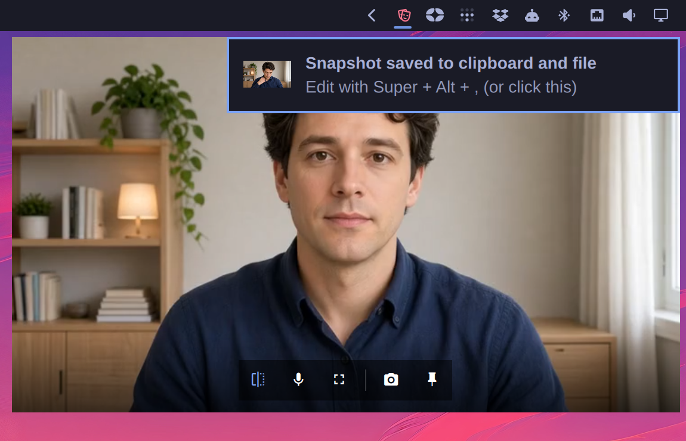

# Green Room

[](https://github.com/joaodrp/omarchy-green-room/actions/workflows/ci.yml)
[](LICENSE)

A quick check of how you look and sound, from the Omarchy bar. It works like
[Hand Mirror](https://handmirror.app/) for macOS. Click the bar icon to see yourself in a
mirrored live preview, click again and the camera turns off.



## Highlights

- 🪞 One click, live 16:9 video, mirrored by default. `m` shows what others see.
- 🔒 The camera runs only while a mirror is showing. Close it and the camera turns off within a
  couple of seconds; nothing streams in the background, ever.
- 🎙️ Mic check: a level meter that puts speech mid-meter, holds peaks, and turns urgent when
  you run hot.
- 📐 Framing guides: rule of thirds, with the top line for your eyes.
- 📌 Pop out: a small always-on-top mirror that follows you across workspaces. Drag to move,
  drag any corner to resize.
- 📸 Snapshot: what the preview shows, saved and announced like an Omarchy screenshot.
- ⌨️ Every control has a key, and the controls stay out of the way until you hover.
- 🎨 Built from the shell's own components. Follows your theme; no settings page to visit.

## Install

```sh
omarchy plugin add https://github.com/joaodrp/omarchy-green-room.git --enable
```

## What it shows

Left click opens the mirror, click again closes it. The preview is dark until the first frame
arrives, then the video fades in. Hover for the controls:

| Control | Key | Does |
| --- | --- | --- |
| Flip | `m` | Mirrored, or as others see you |
| Next camera | `c` | Only with more than one camera; the choice sticks |
| Mic check | `a` | Show or hide the level meter |
| Mic level | `up` `down` | Raise or lower the microphone 5%, with the mic check on |
| Framing guides | `g` | Show or hide the rule-of-thirds lines |
| Snapshot | `s` | Save the current picture |
| Pop out | `p` | Lift the mirror into a corner window |
| | `esc` | Close |



Hovering a chip shows what it does and its key. The mic chip stays reachable even when the
camera is missing or broken, so you can still check your mic.

### Flip



Mirrored by default, because that is how you fix your hair. `m` shows the picture the other
side of the call gets. A snapshot saves whichever is showing.

### Next camera



With more than one camera connected, the camera chip and `c` move to the next one, and the
choice sticks. While that camera is not connected the mirror uses the system default, and it
picks your camera again once it is back.

### Mic check



Normal speech lands mid-meter and moves with every syllable. The top cell lights in the theme's
urgent color when you are too loud. The loudest recent cell keeps glowing for a second, so a peak
you missed still shows.



Hover the meter to see which microphone it reads and at what level. It follows the system
default, so a forgotten headset shows up here. A muted or missing mic shows a slashed glyph
instead of a silently flat bar.

Hovering also tints the cells where speech belongs. Scroll on the meter, or press `up` and
`down`, to move the microphone 5% at a time until your voice lands there. It is the same level as
the input slider in Omarchy's audio panel, so a change in one shows in the other.

### Framing guides



Put your eyes on the top line and your face in the middle third, and you are framed the way
the other side of the call expects. The lines show what a mirror alone cannot: whether you are
centered and at eye height.

### Pop out


The mirror lifts out of the popup into a small always-on-top 16:9 window in the bottom-right
corner that follows you across workspaces. Drag anywhere to move it; drag any corner to resize
it, aspect locked, and the size sticks. The hover chip docks it back into the panel; a click on
the bar icon, or `esc` once the window has focus, closes it outright. The mic meter comes along
when the check is on.

### Snapshot



`s` saves what the preview shows, mirrored or not, 16:9, at camera resolution, as a PNG in your
screenshot directory, copies it to the clipboard, and sends the same notification a screenshot
does. Click it, or press `Super + Alt + ,`, to open the picture in the screenshot editor.
Press `m` first for the picture others see.

## Settings

Set through the bar's widget settings, or inline on the widget's `shell.json` entry:

| Key | Default | Meaning |
| --- | --- | --- |
| `device` | `auto` | Camera; `auto` follows the system default |
| `deviceSerial` | `""` | Saved by `c` to recognize the chosen camera |
| `deviceName` | `""` | Saved by `c` to recognize the chosen camera |
| `mirror` | `true` | Mirror the preview horizontally |
| `micCheck` | `false` | Show the mic level meter |
| `guides` | `false` | Show the framing guides |
| `previewWidth` | `560` | Mirror width in px, 320-960, 16:9 |
| `pinWidth` | `320` | Pinned mirror width in px, 240-960, 16:9; also set by resizing the pin |

To pick a camera by hand, set `device` and clear `deviceSerial` and `deviceName`; `c` is easier.

## Privacy

- **The camera is on only while a mirror shows.** It turns off within about two seconds of the
  last one closing.
- **The microphone is read only while the mic check is on and a mirror is showing.** A Bluetooth
  headset switches to its call mode for that time, so the meter shows the mic a call would use.
  It is released when the mirror closes.
- **Nothing leaves the machine.** No daemon, no background process, no network. A snapshot is
  a file in your pictures directory and nowhere else.

[How it works](docs/how-it-works.md) has the detail.

## Requirements

- Omarchy 4.0 or newer
- Qt Multimedia (`qt6-multimedia`)
- A V4L2 webcam

Everything else ships with Omarchy: `wl-copy`, `magick` and `omarchy-notification-send` for the
snapshot, PipeWire for the meter.

## Scripting

```sh
omarchy-shell io.github.joaodrp.green-room toggle
omarchy-shell io.github.joaodrp.green-room open
omarchy-shell io.github.joaodrp.green-room close   # also closes a popped-out mirror
```

Bind `toggle` to a key for a mirror that needs no mouse at all.

## Contributing

Bug reports and pull requests welcome. See [CONTRIBUTING.md](CONTRIBUTING.md) to get set up, and
[docs/how-it-works.md](docs/how-it-works.md) for how the pieces fit.

## Remove

```sh
omarchy plugin remove io.github.joaodrp.green-room
```

## License

MIT, see [LICENSE](LICENSE).

<sub>The person in the screenshots is AI-generated.</sub>
